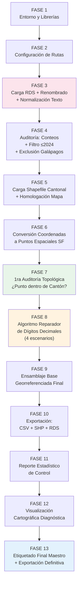
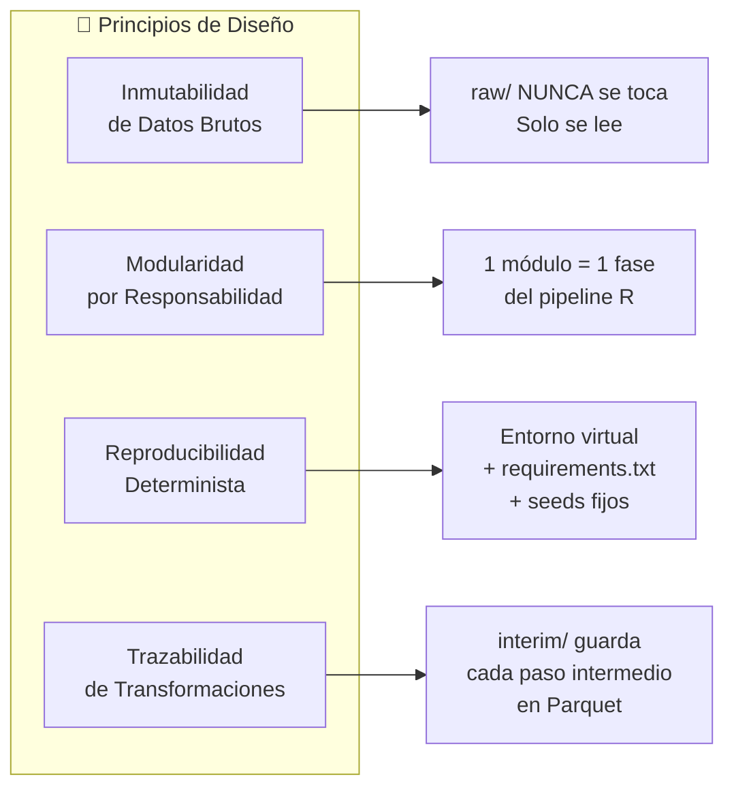
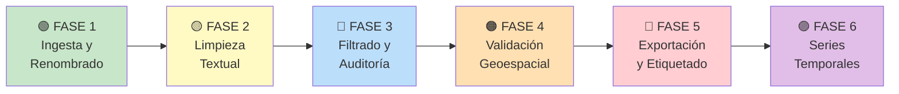

# 🏗️ Arquitectura de Migración R → Python: Preprocesamiento de Homicidios Ecuador

> [!IMPORTANT]
> Este documento es la **guía maestra** del proyecto. Cada fase se implementará incrementalmente en sesiones posteriores. **NO se programa código en esta sesión**.

---

## 1. Análisis del Código R Original

### 1.1 Flujo Lógico Completo (13 Fases identificadas)



### 1.2 Tabla de Equivalencias R → Python

| Concepto R | Función R | Equivalente Python | Librería Python |
|---|---|---|---|
| **Pipe `%>%`** | `dplyr::pipe` | Method chaining (`df.pipe()`) o asignaciones secuenciales | pandas nativo |
| **Lectura RDS** | `readRDS()` | `pyreadr.read_r()` | `pyreadr` |
| **Lectura CSV** | `read.csv()` | `pd.read_csv()` | `pandas` |
| **Renombrar columnas** | `rename()` | `df.rename(columns={})` | `pandas` |
| **Filtrar filas** | `filter()` | `df.query()` o `df[df.col == x]` | `pandas` |
| **Mutar/Crear columnas** | `mutate()` | `df.assign()` o `df['col'] = ...` | `pandas` |
| **Limpiar texto (trim)** | `str_trim()` | `df['col'].str.strip()` | `pandas` |
| **Mayúsculas** | `str_to_upper()` | `df['col'].str.upper()` | `pandas` |
| **Remover acentos** | `iconv(x, to="ASCII//TRANSLIT")` | `unidecode(x)` o `unicodedata.normalize()` + regex | `unidecode` / stdlib |
| **Eliminar NA** | `drop_na()` | `df.dropna(subset=[...])` | `pandas` |
| **Seleccionar columnas** | `select()` | `df[['col1','col2']]` o `df.filter()` | `pandas` |
| **Concatenar filas** | `rbind()` | `pd.concat([df1, df2])` | `pandas` |
| **Valores únicos** | `unique()` | `df['col'].unique()` | `pandas` |
| **Conteo de filas** | `nrow()` | `len(df)` o `df.shape[0]` | `pandas` |
| **Regex buscar** | `grepl()` | `df['col'].str.contains()` | `pandas` |
| **Regex reemplazar** | `gsub()` | `df['col'].str.replace()` | `pandas` |
| **Subcadena** | `str_sub(x, start, end)` | `x[start:end]` / `df['col'].str[start:end]` | `pandas` |
| **Longitud cadena** | `str_length()` | `df['col'].str.len()` | `pandas` |
| **Conversión numérica** | `as.numeric()` | `pd.to_numeric(df['col'], errors='coerce')` | `pandas` |
| **Lectura Shapefile** | `sf::read_sf()` | `gpd.read_file()` | `geopandas` |
| **Transformar CRS** | `st_transform(crs=4326)` | `gdf.to_crs(epsg=4326)` | `geopandas` |
| **Reparar geometrías** | `st_make_valid()` | `gdf.geometry = gdf.make_valid()` | `geopandas` (shapely) |
| **Crear puntos SF** | `st_as_sf(coords=c("x","y"))` | `gpd.GeoDataFrame(df, geometry=gpd.points_from_xy(x,y))` | `geopandas` |
| **Intersección espacial** | `st_intersects(sparse=FALSE)` | `gpd.sjoin(how='inner', predicate='intersects')` | `geopandas` |
| **Escribir Shapefile** | `st_write()` | `gdf.to_file()` | `geopandas` |
| **Gráficos espaciales** | `ggplot() + geom_sf()` | `ax = gdf.plot()` o `matplotlib` | `geopandas` + `matplotlib` |

### 1.3 Decisión de Formato de Ingesta

> [!NOTE]
> El archivo fuente original es `base_homi_2010_2025_original.rds` (formato binario nativo de R). Sin embargo, también existe el CSV equivalente: `base_homi_2010_2025_excel_original.csv` con las mismas 21 columnas. **Para Python usaremos el CSV como fuente principal**, eliminando la dependencia de `pyreadr` para leer RDS. Si el CSV presenta pérdida de tipos (fechas, numéricos), se documentará y se resolverá en la fase de ingesta.

### 1.4 Columnas del Dataset Original (21 campos)

| # | Columna Original | Nombre Descriptivo (R) | Tipo Esperado |
|---|---|---|---|
| 0 | `X2` | `codigo_caso` | `str` |
| 1 | `X4` | `tipo_delito` | `str` (categórica) |
| 2 | `X21` | `latitud` | `float64` (potencialmente corrupto) |
| 3 | `X22` | `longitud` | `float64` (potencialmente corrupto) |
| 4 | `X23` | `zona_tipo` | `str` (Urbano/Rural) |
| 5 | `X28` | `lugar_especifico` | `str` (categórica) |
| 6 | `X33` | `fecha_hecho` | `datetime` o `str` |
| 7 | `X35` | `tipo_arma` | `str` (categórica) |
| 8 | `X39` | `motivacion_detalle` | `str` (categórica) |
| 9 | `X40` | `causa_especifica` | `str` (categórica) |
| 10 | `X45` | `edad_victima` | `int` o `float` |
| 11 | `X47` | `sexo_victima` | `str` (M/F) |
| 12 | `X53` | `nacionalidad_victima` | `str` |
| 13 | `X133` | `canton` | `str` |
| 14 | `X208` | `AUX_HORA_SISTEMA` | `int` o `str` |
| 15 | `X209` | `AUX_MINUTO_SISTEMA` | `int` o `str` |
| 16 | `anio` | `anio_hecho` | `int` |
| 17 | `mes` | `mes_hecho` | `str` (nombre del mes) |
| 18 | `dia` | `dia_semana` | `str` (nombre del día) |
| 19 | `rangoh` | `hora_aproximada` | `str` o `int` |
| 20 | `DPA_DESPRO` | `provincia` | `str` |

---

## 2. Arquitectura y Estructura del Proyecto

### 2.1 Estructura de Carpetas Propuesta

```
D:\Tesis\
├── 📁 data/                          # ── DATOS (Inmutables vs. Procesados)
│   ├── 📁 raw/                       #    Datos BRUTOS originales (NUNCA se modifican)
│   │   ├── base_homi_2010_2025.csv   #    CSV fuente exportado del RDS
│   │   └── 📁 cartografia/           #    Shapefiles cantonales originales
│   │       ├── nxcantones.shp        
│   │       ├── nxcantones.dbf        
│   │       ├── nxcantones.prj        
│   │       ├── nxcantones.shx        
│   │       └── ...                   
│   ├── 📁 interim/                   #    Datos intermedios de cada fase
│   │   ├── homi_renombrado.parquet   
│   │   ├── homi_normalizado.parquet  
│   │   ├── homi_filtrado_2024.parquet
│   │   └── geo_correctos.parquet     
│   └── 📁 processed/                 #    Datos FINALES listos para análisis
│       ├── homi_final_continental.csv
│       ├── homi_final_continental.parquet
│       └── homi_final.gpkg           #    GeoPackage (reemplazo moderno de .shp)
│
├── 📁 src/                           # ── CÓDIGO FUENTE MODULAR
│   ├── __init__.py                   
│   ├── 📁 ingesta/                   #    Fase 1-2: Carga y configuración
│   │   ├── __init__.py               
│   │   ├── cargar_datos.py           #    Lectura CSV + tipado + renombrado
│   │   └── config.py                 #    Rutas, constantes, parámetros globales
│   ├── 📁 limpieza/                  #    Fase 3: Normalización de texto
│   │   ├── __init__.py               
│   │   ├── normalizar_texto.py       #    strip + upper + remove accents
│   │   └── filtros.py                #    Filtro año ≤2024, exclusión Galápagos
│   ├── 📁 validacion_geo/            #    Fases 5-9: Todo el pipeline geoespacial
│   │   ├── __init__.py               
│   │   ├── cargar_cartografia.py     #    Lectura shapefile + homologación
│   │   ├── crear_puntos.py           #    Conversión coords → GeoDataFrame
│   │   ├── auditoria_topologica.py   #    Point-in-polygon: correctos vs. limbo
│   │   ├── reparar_coordenadas.py    #    Algoritmo de reparación decimal (4 escenarios)
│   │   └── ensamblaje.py             #    Concatenación de registros reparados
│   ├── 📁 exportacion/               #    Fase 10+13: Salida final
│   │   ├── __init__.py               
│   │   ├── exportar.py               #    CSV, Parquet, GeoPackage
│   │   └── etiquetado_final.py       #    Selección y renombrado definitivo
│   ├── 📁 reportes/                  #    Fases 4, 11, 12: Auditoría y visualización
│   │   ├── __init__.py               
│   │   ├── auditoria_caracteres.py   #    Detección de tildes/eñes residuales
│   │   ├── reporte_control.py        #    Conteos y métricas de calidad
│   │   └── visualizacion_mapa.py     #    Mapa diagnóstico con matplotlib
│   └── 📁 utils/                     #    Utilidades compartidas
│       ├── __init__.py               
│       └── texto.py                  #    Funciones reutilizables de limpieza de strings
│
├── 📁 notebooks/                     # ── EXPLORACIÓN (Jupyter)
│   ├── 01_exploracion_datos.ipynb    #    EDA inicial del CSV crudo
│   ├── 02_validacion_limpieza.ipynb  #    Verificación visual de cada paso
│   └── 03_mapa_diagnostico.ipynb     #    Visualización cartográfica interactiva
│
├── 📁 tests/                         # ── PRUEBAS AUTOMATIZADAS
│   ├── __init__.py                   
│   ├── test_normalizar_texto.py      
│   ├── test_filtros.py               
│   └── test_reparar_coordenadas.py   
│
├── 📁 docs/                          # ── DOCUMENTACIÓN TÉCNICA
│   └── diccionario_datos.md          #    Diccionario de variables y transformaciones
│
├── 📁 R_legacy/                      # ── CÓDIGO R ORIGINAL (referencia)
│   └── preprocesamiento_general.R    #    El script R original para consulta
│
├── main.py                           # ── ORQUESTADOR: ejecuta todo el pipeline
├── requirements.txt                  # ── DEPENDENCIAS con versiones pinned
├── pyproject.toml                    # ── Metadata del proyecto (opcional, recomendado)
├── .gitignore                        
└── README.md                         # ── Guía técnica del proyecto
```

### 2.2 Principios Arquitectónicos



1. **Inmutabilidad de `data/raw/`**: Los archivos originales jamás se modifican. Toda transformación se lee de `raw/` y se escribe en `interim/` o `processed/`.
2. **Modularidad por responsabilidad**: Cada subdirectorio de `src/` encapsula una fase lógica del pipeline R. Esto permite testear, depurar y evolucionar cada fase independientemente.
3. **Reproducibilidad**: Entorno virtual aislado + `requirements.txt` con versiones exactas + semillas aleatorias fijas.
4. **Parquet como formato intermedio**: Reemplaza los `.rds` de R. Es binario, columnar, tipado, y ~5x más rápido que CSV para lectura/escritura.
5. **GeoPackage en lugar de Shapefile**: `.gpkg` es el estándar moderno OGC (un solo archivo, sin límite de 10 caracteres en nombres de columnas, soporta UTF-8 nativo).

### 2.3 Esqueleto del README.md

El `README.md` raíz del proyecto deberá contener:

```markdown
# Preprocesamiento de Datos de Homicidios — Ecuador (2010-2024)

## Descripción
Pipeline de preprocesamiento de datos de homicidios para Ecuador continental,
migrado desde R. Incluye limpieza textual, validación geoespacial y reparación
de coordenadas corruptas para preparar datos limpios para modelos de series
temporales.

## Requisitos
- Python 3.13
- Entorno virtual (`.venv`)
- Dependencias: ver `requirements.txt`

## Instalación
(comandos del entorno virtual — ver Sección 3 de este documento)

## Uso
python main.py

## Estructura del Proyecto
(referencia a la estructura de carpetas)

## Fases del Pipeline
1. Ingesta y renombrado de columnas
2. Normalización textual (mayúsculas, tildes)
3. Filtrado temporal (≤2024) y geográfico (sin Galápagos)
4. Carga cartográfica y homologación de cantones
5. Validación punto-en-polígono
6. Reparación de coordenadas decimales corruptas
7. Ensamblaje y exportación final

## Origen de Datos
- Fuente: [describir proveedor oficial]
- Periodo: 2010-2025 (filtrado a 2024)
- Formato original: RDS/CSV con 21 columnas codificadas
```

---

## 3. Configuración del Entorno Aislado (Python 3.13)

### 3.1 Creación del Entorno Virtual

> [!TIP]
> Tu sistema tiene `py -3.13` disponible (`Python 3.13.17`). Usaremos el launcher `py` para garantizar la versión exacta.

```powershell
# 1. Navegar al directorio raíz del proyecto
cd D:\Tesis

# 2. Crear el entorno virtual con Python 3.13 exacto
py -3.13 -m venv .venv

# 3. Activar el entorno virtual
.\.venv\Scripts\Activate.ps1

# 4. Verificar la versión activa
python --version
# Debe mostrar: Python 3.13.x

# 5. Actualizar pip y setuptools dentro del venv
python -m pip install --upgrade pip setuptools wheel
```

### 3.2 Archivo `requirements.txt` Planificado

```txt
# ============================================================
# DEPENDENCIAS DEL PROYECTO: Homicidios Ecuador (2010-2024)
# Python 3.13 | Entorno Virtual Aislado
# ============================================================

# ── CORE: Manipulación de Datos ──
pandas>=2.2,<3.0          # DataFrames, equivalente a dplyr/tidyr
pyarrow>=18.0             # Motor Parquet (lectura/escritura columnar rápida)

# ── GEOESPACIAL ──
geopandas>=1.0,<2.0       # Equivalente a sf:: de R (GeoDataFrames)
shapely>=2.0              # Geometrías (puntos, polígonos, intersecciones)
pyproj>=3.7               # Proyecciones CRS (equivalente a st_transform)
fiona>=1.10               # Backend para lectura de Shapefiles/GeoPackage

# ── LIMPIEZA DE TEXTO ──
unidecode>=1.3            # Equivalente a iconv(to="ASCII//TRANSLIT")

# ── VISUALIZACIÓN ──
matplotlib>=3.9           # Gráficos base + mapas estáticos
# seaborn>=0.13          # Opcional: gráficos estadísticos elegantes

# ── SERIES TEMPORALES (Fase futura) ──
# statsmodels>=0.14      # ARIMA, descomposición, tests estacionariedad
# prophet>=1.1           # Facebook Prophet para pronósticos
# scikit-learn>=1.5      # Métricas, validación cruzada temporal

# ── DESARROLLO Y CALIDAD ──
# pytest>=8.0            # Testing automatizado
# jupyter>=1.0           # Notebooks para exploración
# ruff>=0.8              # Linter + formatter ultrarrápido

# ── LECTURA DE FORMATO R (Opcional) ──
# pyreadr>=0.5           # Solo si se necesita leer .rds directamente
```

### 3.3 Instalación de Dependencias

```powershell
# Con el entorno activado (.venv):
python -m pip install pandas pyarrow geopandas shapely pyproj fiona unidecode matplotlib

# Congelar las versiones exactas instaladas:
python -m pip freeze > requirements.lock
```

### 3.4 Buenas Prácticas del Entorno

| Práctica | Detalle |
|---|---|
| **`.gitignore`** | Agregar `.venv/`, `data/raw/`, `data/interim/`, `__pycache__/`, `*.pyc` |
| **No instalar globalmente** | SIEMPRE activar el venv antes de `pip install` |
| **`requirements.lock`** | Mantener un freeze con versiones exactas para reproducibilidad |
| **Sin Conda** | Usar `venv` puro para evitar conflictos con gestores mixtos |
| **Verificación** | Ejecutar `python -c "import pandas; import geopandas; print('OK')"` tras instalar |

---

## 4. Hoja de Ruta (Roadmap) Paso a Paso

### Vista General de Fases



---

### 🟢 FASE 1 — Ingesta, Configuración y Renombrado
**Corresponde a:** Fases R 1-3 (líneas 1-77)
**Entregables:** `src/ingesta/config.py`, `src/ingesta/cargar_datos.py`, `data/interim/homi_renombrado.parquet`

| Paso | Tarea | Detalle |
|---|---|---|
| 1.1 | Crear estructura de carpetas | Generar los directorios vacíos del proyecto |
| 1.2 | Copiar datos brutos | Mover `base_homi_2010_2025_excel_original.csv` → `data/raw/` y los shapefiles → `data/raw/cartografia/` |
| 1.3 | Escribir `config.py` | Definir `Path` constants: `RAW_DIR`, `INTERIM_DIR`, `PROCESSED_DIR`, `CARTOGRAFIA_DIR` |
| 1.4 | Escribir `cargar_datos.py` | Función `cargar_homicidios_raw()`: lee CSV con tipos explícitos (`dtype`), renombra 21 columnas |
| 1.5 | Guardar intermedio | Exportar como `homi_renombrado.parquet` en `interim/` |
| 1.6 | Validar | Comparar `df.shape`, `df.dtypes`, `df.head()` contra los datos de R |

**Mapeo de funciones R → Python en esta fase:**
```
readRDS() / read.csv()  →  pd.read_csv(dtype={...})
rename()                →  df.rename(columns={...})
```

---

### 🟡 FASE 2 — Limpieza y Normalización Textual
**Corresponde a:** Fase R 3 (líneas 81-130) + Auditoría de caracteres (líneas 153-186)
**Entregables:** `src/limpieza/normalizar_texto.py`, `src/utils/texto.py`, `src/reportes/auditoria_caracteres.py`

| Paso | Tarea | Detalle |
|---|---|---|
| 2.1 | Función `normalizar_columna()` | `strip()` → `upper()` → `unidecode()` en una sola función reutilizable |
| 2.2 | Aplicar a las 13 columnas texto | Idéntica lógica que el `mutate()` con `iconv()` + `str_trim()` + `str_to_upper()` |
| 2.3 | Auditoría de caracteres especiales | Regex `[áéíóúÁÉÍÓÚñÑüÜ]` por columna, reportar hallazgos |
| 2.4 | Guardar intermedio | `data/interim/homi_normalizado.parquet` |
| 2.5 | Test unitario | `test_normalizar_texto.py`: verificar que no queden tildes/eñes |

**Mapeo de funciones R → Python en esta fase:**
```
str_trim()              →  .str.strip()
str_to_upper()          →  .str.upper()
iconv(to="ASCII//T")    →  unidecode()
grepl(patron, col)      →  .str.contains(patron, regex=True)
```

---

### 🔵 FASE 3 — Filtrado Temporal/Geográfico y Auditoría de Control
**Corresponde a:** Fases R 3 (líneas 132-150) + 4 (líneas 190-203)
**Entregables:** `src/limpieza/filtros.py`, `src/reportes/reporte_control.py`

| Paso | Tarea | Detalle |
|---|---|---|
| 3.1 | Conversión de `anio_hecho` a int | `pd.to_numeric(errors='coerce')` + `dropna()` |
| 3.2 | Filtro temporal | `df.query('anio_hecho <= 2024')` |
| 3.3 | Exclusión Galápagos | `~df['canton'].isin(['GALAPAGOS','ISABELA','SANTA CRUZ','SAN CRISTOBAL'])` |
| 3.4 | Separar insular | Guardar registros insulares por separado para trazabilidad |
| 3.5 | Reporte de conteos | Registros originales vs. filtrados vs. excluidos |
| 3.6 | Guardar intermedio | `data/interim/homi_filtrado_2024.parquet` |
| 3.7 | Test unitario | `test_filtros.py`: verificar que no existan registros 2025 ni cantones insulares |

**Mapeo de funciones R → Python en esta fase:**
```
as.numeric()            →  pd.to_numeric(errors='coerce')
filter(anio <= 2024)    →  df.query('anio_hecho <= 2024')
drop_na()               →  df.dropna(subset=['anio_hecho'])
filter(!x %in% lista)   →  df[~df['col'].isin(lista)]
nrow()                  →  len(df) o df.shape[0]
```

---

### 🟠 FASE 4 — Validación Geoespacial Completa
**Corresponde a:** Fases R 5-9 (líneas 206-484). **Es la fase más compleja.**
**Entregables:** Todos los módulos en `src/validacion_geo/`

| Paso | Tarea | Detalle |
|---|---|---|
| **4.1** | **Carga cartográfica** | `gpd.read_file('nxcantones.shp')`, `.to_crs(epsg=4326)`, `.make_valid()` |
| **4.2** | **Homologar mapa** | Crear columna `CANTON_MAPA` = `strip + upper + unidecode` sobre `DPA_DESCAN` |
| | | Excluir Galápagos + "ZONA NO DELIMITADA" del mapa |
| **4.3** | **Crear puntos** | `pd.to_numeric()` las columnas lat/lon, eliminar NaN |
| | | `gpd.GeoDataFrame(geometry=gpd.points_from_xy(lon, lat), crs=4326)` |
| | | Agregar `ID_temp` = rango secuencial |
| **4.4** | **1ra Auditoría topológica** | `gpd.sjoin()` entre puntos y polígonos del mismo cantón |
| | | Separar: `geo_correctos` (caen dentro) vs. `geo_corregir` (no caen) |
| **4.5** | **Separar por formato** | Los del limbo: con punto decimal → `limbo_formato_correcto` |
| | | Sin punto decimal → `geo_corregir_decimales` |
| **4.6** | **Algoritmo reparador** | 4 escenarios de reconstrucción decimal: |
| | | ① `X.XXXXXX` (positivo Norte) |
| | | ② `0.XXXXXX` (positivo cerca del ecuador) |
| | | ③ `-X.XXXXXX` (negativo Sur — **el más crítico**) |
| | | ④ `-0.XXXXXX` (negativo cerca del ecuador) |
| | | Para cada escenario: reconstruir lat → crear puntos → `sjoin` → clasificar |
| **4.7** | **Ensamblaje** | `pd.concat([geo_correctos, reparados_1..4, limbo_formato_correcto])` |
| | | Limpiar columnas auxiliares, validar `dropna(lat, lon)` |
| **4.8** | **Guardar** | `data/interim/geo_correctos.parquet`, `processed/homi_georreferenciado.parquet` |
| **4.9** | **Tests** | `test_reparar_coordenadas.py`: con coordenadas sintéticas conocidas |

> [!WARNING]
> El algoritmo de reparación decimal del R (Fase 8, líneas 300-457) es el componente más delicado. Requiere reproducir exactamente los 4 escenarios de reconstrucción. Se recomienda implementar cada escenario como una función independiente con tests unitarios antes de integrarlos.

**Mapeo de funciones R → Python clave en esta fase:**
```
read_sf()               →  gpd.read_file()
st_transform(crs=4326)  →  gdf.to_crs(epsg=4326)
st_make_valid()         →  gdf.make_valid()
st_as_sf(coords=...)    →  gpd.GeoDataFrame(geometry=gpd.points_from_xy(...))
st_intersects()         →  gpd.sjoin(predicate='intersects')
sf_use_s2(FALSE)        →  No aplica (geopandas usa GEOS/planar por defecto)
str_sub(x, 1, 1)        →  x.str[0]
str_length(x)           →  x.str.len()
paste0("-", x, ".", y)  →  "-" + x + "." + y  (o f-strings)
rbind()                 →  pd.concat()
```

> [!TIP]
> **Optimización clave**: El bucle R `for(j in 1:length(cantones))` con `st_intersects` uno por uno es muy lento. En Python, un solo `gpd.sjoin()` entre **todos** los puntos y **todos** los polígonos reemplaza el bucle completo y es **órdenes de magnitud más rápido** gracias a un índice espacial R-tree interno.

---

### 🔴 FASE 5 — Etiquetado Final, Exportación y Visualización
**Corresponde a:** Fases R 10-13 (líneas 486-627)
**Entregables:** `src/exportacion/`, `src/reportes/`, archivos finales en `data/processed/`

| Paso | Tarea | Detalle |
|---|---|---|
| 5.1 | Selección y renombrado definitivo | `df[columnas_finales].rename(columns={...})` — 21 columnas limpias |
| 5.2 | Exportar CSV final | `df.to_csv('homi_Final_Continental_Etiquetado.csv', index=False)` |
| 5.3 | Exportar Parquet | `df.to_parquet(...)` — formato rápido para Python futuro |
| 5.4 | Exportar GeoPackage | `gdf.to_file('homi_final.gpkg', driver='GPKG')` — reemplazo de `.shp` |
| 5.5 | Reporte estadístico | Conteos totales, tasa de rescate, efectividad del pipeline |
| 5.6 | Mapa diagnóstico | `matplotlib` + `geopandas.plot()`: puntos rojos sobre provincias grises |

---

### 🟣 FASE 6 — Preparación para Series Temporales *(Futuro)*
**No está en el código R actual. Es la siguiente etapa del proyecto de tesis.**

| Paso | Tarea | Detalle |
|---|---|---|
| 6.1 | Agregación temporal | Conteo mensual/semanal de homicidios por provincia/cantón |
| 6.2 | Verificar completitud temporal | Detectar meses sin datos (imputar con 0 o interpolar) |
| 6.3 | Crear índice temporal | `pd.DatetimeIndex` con frecuencia mensual |
| 6.4 | Descomposición | Tendencia + estacionalidad + residuo (`statsmodels`) |
| 6.5 | Tests de estacionariedad | ADF, KPSS |
| 6.6 | Feature engineering | Lags, rolling means, variables calendario |
| 6.7 | Modelado inicial | ARIMA / Prophet / LSTM como baseline |

---

### Cronograma Sugerido de Implementación

| Sesión | Fase | Duración Estimada | Dependencia |
|---|---|---|---|
| **Sesión 2** | 🟢 Fase 1: Ingesta + Estructura | 30-45 min | Ninguna |
| **Sesión 3** | 🟡 Fase 2: Limpieza textual | 30-45 min | Fase 1 |
| **Sesión 4** | 🔵 Fase 3: Filtros + Auditoría | 20-30 min | Fase 2 |
| **Sesión 5** | 🟠 Fase 4a: Carga carto + Puntos + 1ra auditoría | 45-60 min | Fase 3 |
| **Sesión 6** | 🟠 Fase 4b: Reparación decimal (4 escenarios) | 60-90 min | Fase 4a |
| **Sesión 7** | 🔴 Fase 5: Etiquetado + Exportación + Mapa | 30-45 min | Fase 4b |
| **Sesión 8+** | 🟣 Fase 6: Series temporales | Variable | Fase 5 |

---

## 5. `main.py` — Orquestador Conceptual

```python
"""
main.py — Orquestador del pipeline de preprocesamiento.
Ejecuta todas las fases en secuencia.
"""
from src.ingesta.config import RAW_DIR, INTERIM_DIR, PROCESSED_DIR
from src.ingesta.cargar_datos import cargar_homicidios_raw
from src.limpieza.normalizar_texto import normalizar_todas_columnas
from src.limpieza.filtros import filtrar_anio, excluir_galapagos
from src.reportes.auditoria_caracteres import auditar_caracteres_especiales
from src.reportes.reporte_control import imprimir_conteos
from src.validacion_geo.cargar_cartografia import cargar_mapa_cantonal
from src.validacion_geo.crear_puntos import crear_geodataframe_puntos
from src.validacion_geo.auditoria_topologica import auditar_punto_en_poligono
from src.validacion_geo.reparar_coordenadas import reparar_coordenadas_corruptas
from src.validacion_geo.ensamblaje import ensamblar_base_final
from src.exportacion.etiquetado_final import etiquetar_columnas_finales
from src.exportacion.exportar import exportar_todos_formatos
from src.reportes.reporte_control import imprimir_reporte_final
from src.reportes.visualizacion_mapa import generar_mapa_diagnostico


def main():
    # ── FASE 1: Ingesta ──
    df = cargar_homicidios_raw()

    # ── FASE 2: Limpieza textual ──
    df = normalizar_todas_columnas(df)
    auditar_caracteres_especiales(df)

    # ── FASE 3: Filtrado ──
    df = filtrar_anio(df, hasta=2024)
    df_continental, df_insular = excluir_galapagos(df)
    imprimir_conteos(df_original=df, df_filtrado=df_continental)

    # ── FASE 4: Validación geoespacial ──
    mapa = cargar_mapa_cantonal()
    gdf_puntos = crear_geodataframe_puntos(df_continental)
    correctos, limbo = auditar_punto_en_poligono(gdf_puntos, mapa)
    reparados = reparar_coordenadas_corruptas(limbo, mapa)
    df_final = ensamblar_base_final(correctos, reparados)

    # ── FASE 5: Exportación ──
    df_etiquetado = etiquetar_columnas_finales(df_final)
    exportar_todos_formatos(df_etiquetado)
    imprimir_reporte_final(df_etiquetado)
    generar_mapa_diagnostico(df_etiquetado, mapa)


if __name__ == "__main__":
    main()
```

> [!NOTE]
> Este `main.py` es **conceptual**: muestra cómo se conectarán los módulos. Se irá llenando a medida que implementemos cada fase en las sesiones siguientes.

---

## 6. Decisiones Técnicas y Notas de Diseño

### ¿Por qué Parquet en lugar de RDS/CSV para intermedios?
- **Tipado estricto**: Preserva `int`, `float`, `datetime`, `string` sin ambigüedad (CSV pierde tipos).
- **Velocidad**: Lectura/escritura ~5-10x más rápida que CSV para datasets grandes.
- **Tamaño**: Compresión columnar nativa (Snappy) → archivos ~3-4x más pequeños.
- **Interoperabilidad**: Legible en Python, R, Spark, DuckDB, Polars.

### ¿Por qué GeoPackage (`.gpkg`) en lugar de Shapefile (`.shp`)?
- Un solo archivo (vs. 4-7 archivos `.shp`/`.dbf`/`.shx`/`.prj`).
- Nombres de columnas sin límite de 10 caracteres.
- Soporte nativo UTF-8 (sin problemas con tildes en metadatos).
- Estándar OGC abierto, compatible con QGIS y ArcGIS.

### ¿`sf_use_s2(FALSE)` tiene equivalente en Python?
No se necesita. **GeoPandas usa GEOS** (geometría planar) por defecto, no S2. Así que el comportamiento ya es equivalente al `sf_use_s2(FALSE)` de R.

### Optimización del bucle de intersección espacial
El código R itera cantón por cantón con un `for(j in ...)`. En Python, `gpd.sjoin()` hace un spatial join vectorizado usando un R-tree, procesando **todos los puntos contra todos los polígonos en una sola operación**. Esto elimina el bucle completamente y reduce el tiempo de O(n×m) a O(n log m).

