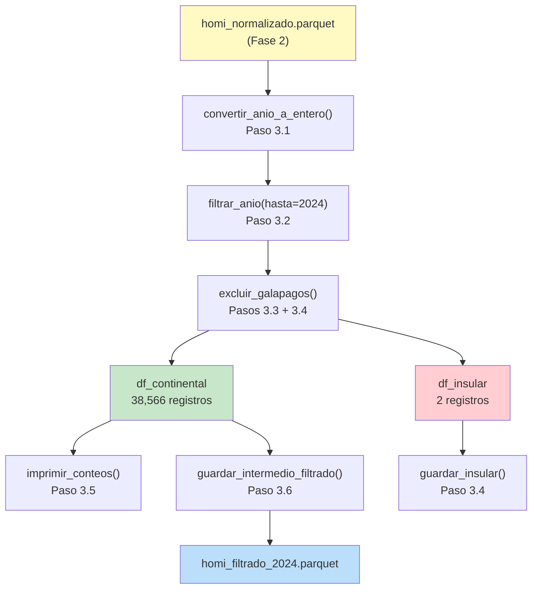

# ✅ FASE 3 — Filtrado Temporal/Geográfico y Auditoría de Control

## Resultado de la Ejecución

| Métrica | Valor |
|---|---|
| Registros originales (entrada Fase 3) | **47,739** |
| (-) Eliminados por conversión NaN | 0 |
| (-) Excluidos por año > 2024 | 9,171 (año 2025) |
| (-) Registros insulares (Galápagos) | 2 (SANTA CRUZ) |
| **(=) REGISTROS CONTINENTAL FINAL** | **38,566** |
| Tasa de retención | **80.79%** |
| ✅ Verificación de integridad | `0 + 9,171 + 2 + 38,566 = 47,739` |

---

## Archivos Creados/Actualizados

### Nuevos (3 archivos)
| Archivo | Paso | Descripción |
|---|---|---|
| [`src/limpieza/filtros.py`](file:///D:/Tesis/src/limpieza/filtros.py) | 3.1–3.6 | Módulo principal: conversión tipo, filtro año, exclusión Galápagos, persistencia Parquet |
| [`src/reportes/reporte_control.py`](file:///D:/Tesis/src/reportes/reporte_control.py) | 3.5 | Auditoría de conteos: originales vs. filtrados vs. excluidos con verificación de integridad |
| [`tests/test_filtros.py`](file:///D:/Tesis/tests/test_filtros.py) | 3.7 | 25 tests: unitarios con datos simulados + integración con datos reales |

### Actualizado
| Archivo | Cambio |
|---|---|
| [`main.py`](file:///D:/Tesis/main.py) | Integración completa de Fase 3 en el pipeline orquestador |

### Datos Generados
| Archivo | Contenido |
|---|---|
| `data/interim/homi_filtrado_2024.parquet` | Dataset continental filtrado (38,566 registros, 1,216 KB) |
| `data/interim/homi_insular_excluido.parquet` | Registros insulares para trazabilidad (2 registros) |

---

## Tests

```
56 passed in 2.62s (25 Fase 3 + 31 Fases anteriores)
```

### Cobertura de Tests por Paso

| Clase | Tests | Paso |
|---|---|---|
| `TestConvertirAnioAEntero` | 6 | 3.1 — Conversión `as.numeric()` → `pd.to_numeric()` |
| `TestFiltrarAnio` | 7 | 3.2 — Filtro `filter(anio <= 2024)` → `df.query()` |
| `TestExcluirGalapagos` | 6 | 3.3/3.4 — Exclusión `!x %in% lista` → `~isin()` |
| `TestReporteControl` | 2 | 3.5 — Auditoría `nrow()` → `len(df)` |
| `TestValidacionDatosReales` | 4 | 3.7 — Validación sobre `homi_normalizado.parquet` real |

---

## Mapeo R → Python Implementado

```
as.numeric(anio_hecho)          →  pd.to_numeric(df['anio_hecho'], errors='coerce')
drop_na(anio_hecho)             →  df.dropna(subset=['anio_hecho'])
filter(anio_hecho <= 2024)      →  df.query('anio_hecho <= @anio_limite')
filter(!canton %in% c(...))     →  df[~df['canton'].isin(CANTONES_GALAPAGOS)]
nrow(df)                        →  len(df)
cat("Total:", nrow(df))         →  print(f"Total: {len(df):,}")
```

---

## Arquitectura de Funciones


