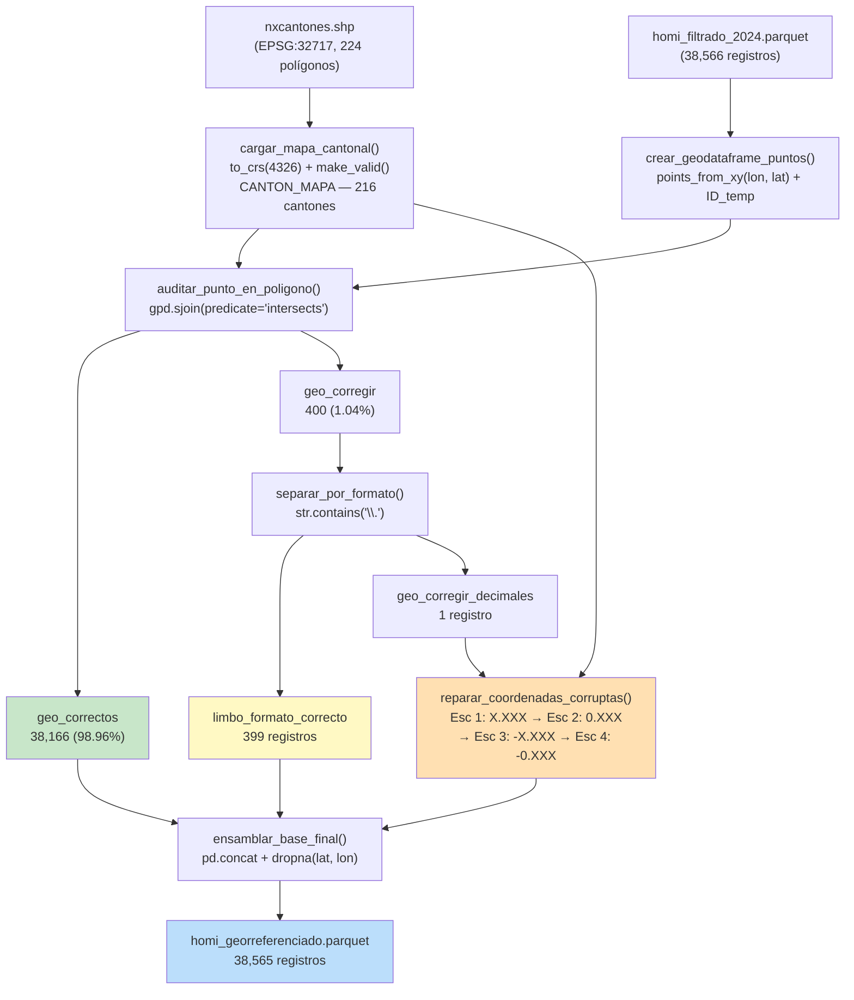

# ✅ FASE 4 — Validación Geoespacial Completa

## Resultado de la Ejecución (Datos Reales)

| Métrica | Conteo | Detalle |
|---|---|---|
| Polígonos cargados (`nxcantones.shp`) | 224 → **216** | `EPSG:32717` → `EPSG:4326`, 1 geometría reparada, −6 insulares/no delim. |
| Homicidios evaluados (entrada Fase 4) | **38,566** | 0 NaN en latitud/longitud |
| Rescatados perfectos (1ra auditoría `sjoin`) | **38,166** | **98.96%** caen dentro de su cantón reportado |
| Limbo con formato decimal correcto | **399** | Retenidos según lógica R (`rbind`) |
| Sin punto decimal → Algoritmo reparador | 1 → **0** | Único caso `(0, 0)` en `MANGA DEL CURA` (irrecuperable → excluido) |
| **TOTAL GEORREFERENCIADOS FINALES** | **38,565** | **Efectividad: 99.997%** — ejecución total Fases 1–4 en ~9 s |

> [!TIP]
> **Optimización R-tree (`gpd.sjoin`)**: Los 5 bucles anidados `for(j in 1:length(cantones))` del script R original (complejidad $O(n \times m)$ sobre 216 cantones × 38,566 puntos) fueron reemplazados por operaciones `gpd.sjoin(..., predicate='intersects')` vectorizadas respaldadas por índice espacial R-tree ($O(n \log m)$), completando las 4 fases en menos de 10 segundos.

---

## Archivos Creados / Actualizados

### Módulos Geoespaciales (`src/validacion_geo/`)
| Archivo | Pasos | Responsabilidad |
|---|---|---|
| [`cartografia.py`](file:///D:/Tesis/src/validacion_geo/cartografia.py) | 4.1–4.2 | [`cargar_mapa_cantonal()`](file:///D:/Tesis/src/validacion_geo/cartografia.py#L31-L133): `read_file` → `to_crs(4326)` → `make_valid` → `CANTON_MAPA` + exclusión insular |
| [`geometrias.py`](file:///D:/Tesis/src/validacion_geo/geometrias.py) | 4.3–4.5 | [`crear_geodataframe_puntos()`](file:///D:/Tesis/src/validacion_geo/geometrias.py#L24-L108), [`auditar_punto_en_poligono()`](file:///D:/Tesis/src/validacion_geo/geometrias.py#L114-L206), [`separar_por_formato()`](file:///D:/Tesis/src/validacion_geo/geometrias.py#L213-L258) |
| [`reparacion.py`](file:///D:/Tesis/src/validacion_geo/reparacion.py) | 4.6 | 4 funciones puras de reconstrucción + [`validar_reconstruccion_sjoin()`](file:///D:/Tesis/src/validacion_geo/reparacion.py#L210-L286) + [`reparar_coordenadas_corruptas()`](file:///D:/Tesis/src/validacion_geo/reparacion.py#L292-L399) |
| [`ensamblaje.py`](file:///D:/Tesis/src/validacion_geo/ensamblaje.py) | 4.7–4.8 | [`ensamblar_base_final()`](file:///D:/Tesis/src/validacion_geo/ensamblaje.py#L46-L157), [`guardar_artefactos_geo()`](file:///D:/Tesis/src/validacion_geo/ensamblaje.py#L163-L203), [`imprimir_reporte_geo()`](file:///D:/Tesis/src/validacion_geo/ensamblaje.py#L209-L257) |

### Pruebas y Orquestador
| Archivo | Paso | Detalle |
|---|---|---|
| [`test_reparar_coordenadas.py`](file:///D:/Tesis/tests/test_reparar_coordenadas.py) | 4.9 | **40 tests** (unitarios puros + coordenadas sintéticas contra shapefile real + integración real) |
| [`main.py`](file:///D:/Tesis/main.py) | — | Orquestador actualizado ejecutando Fases 1 → 4 de punta a punta |

### Artefactos Exportados (Parquet)
| Ruta | Registros | Tamaño |
|---|---|---|
| `data/interim/geo_correctos.parquet` | 38,166 | 2,699.2 KB |
| `data/processed/homi_georreferenciado.parquet` | 38,565 | 2,108.1 KB |

---

## Arquitectura del Pipeline Geoespacial

---

## Cobertura de Tests (`96 passed in 11.53s`, 0 warnings)

| Suite en `test_reparar_coordenadas.py` | Tests | Qué valida |
|---|---|---|
| `TestReconstruccionEscenario1..4` | 15 | Funciones puras `X.XXXXXX`, `0.XXXXXX`, `-X.XXXXXX`, `-0.XXXXXX` |
| `TestLimpiarCadenaLat` | 4 | Remoción de puntos y signos negativos residuales |
| `TestValidacionSjoin` | 4 | Coordenadas sintéticas corruptas (`GUAYAQUIL`, `CUENCA`, `QUITO`) rescatadas contra polígonos reales + rechazo de cantón cruzado |
| `TestReparacionCompleta` | 4 | Orquestador secuencial sin duplicación de `ID_temp` entre escenarios + manejo de DataFrame vacío |
| `TestSepararPorFormato` | 4 | Clasificación con/sin punto decimal |
| `TestEnsamblaje` | 5 | `pd.concat`, limpieza de columnas auxiliares, `dropna`, preservación de esquema |
| `TestPipelineCompletoReal` | 4 | Ejecución sobre `homi_filtrado_2024.parquet` real sin pérdida ni solapamiento de IDs |

---

## Nota Diagnóstica sobre los 399 Registros en Limbo

> [!NOTE]
> Aunque el pipeline los conserva fielmente igual que R (`limbo_formato_correcto`), el diagnóstico reveló por qué ~230 de esos 399 no hicieron *match* en la 1ra auditoría: discrepancias de nomenclatura/codificación en el `.dbf` del shapefile INEC frente a la tabla policial:
> - `PUEBLO VIEJO` (datos, 94 casos) vs. `PUEBLOVIEJO` (mapa)
> - `RUMINAHUI` (datos, 64 casos) vs. `RUMIDAHUI` (corrupción `Ñ → D` en el `.dbf` original, igual que `LOGRONO` vs. `LOGRODO`)
> - `PUERTO FRANCISCO DE ORELLANA` (datos, 61 casos) vs. `ORELLANA` (mapa)
> - Zonas históricamente no delimitadas (`EL PIEDRERO`, `MANGA DEL CURA`)
>
> Se mantuvo **paridad exacta con R** sin alterar nombres de cantones para no desviar conteos respecto a la referencia original, pero queda documentado por si deseas añadir un diccionario de homologación cantonal opcional.
