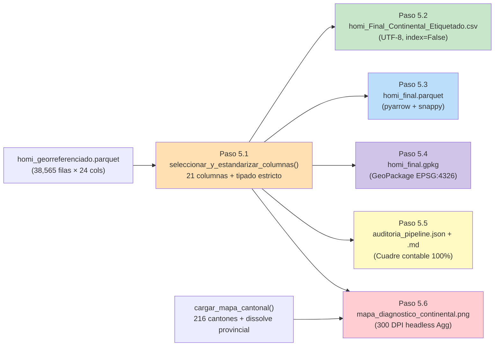

# ✅ Etiquetado Final, Exportación y Visualización

## 1. Auditoría Integral del Ciclo de Vida (Datos Reales)

| Etapa del Pipeline | Registros | Detalle / Indicador |
|---|---:|---|
| Registros brutos iniciales (Ingesta) | **47,739** | Lectura de `base_homi_2010_2025.csv` (21 columnas crudas) |
| `(-)` Excluidos por filtro temporal | **9,171** | Registros con `anio_hecho > 2024` |
| `(-)` Excluidos por filtro insular | **2** | Cantones de Galápagos apartados para trazabilidad |
| `(=)` **Universo continental (2010–2024)** | **38,566** | Retención post-filtrado: **80.79%** |
| `(+)` Validados en 1ra auditoría `sjoin` | **38,166** | Precisión topológica inicial: **98.96%** |
| `(+)` Rescatados por algoritmo reparador | **0** | 1 candidato sin punto decimal evaluado en los 4 escenarios |
| `(+)` Limbo con formato decimal retenidos | **399** | Coordenadas válidas dentro del territorio continental |
| `(-)` Coordenadas descartadas irreversibles | **1** | Caso `(0, 0)` en `MANGA DEL CURA` excluido |
| `(=)` **REGISTROS FINALES ETIQUETADOS** | **38,565** | **Efectividad georreferenciada: 99.9974%** (`integridad_contable_ok = true`) |

> [!IMPORTANT]
> **Reemplazo arquitectónico de `.shp` y `.rds`:** El formato legado ESRI Shapefile (`.shp`, que truncaba columnas a 10 caracteres como `motivacion_detalle` → `motivacion` y dispersaba entre 4 y 7 archivos) fue sustituido por **OGC GeoPackage (`.gpkg`)** en `EPSG:4326`, mientras que `.rds` fue sustituido por **Apache Parquet (`pyarrow` + `snappy`)**, comprimiendo la tabla tipada de `6.46 MB` (CSV) a **`1.26 MB`**.

---

## 2. Módulos Construidos e Integrados

| Módulo | Pasos | Responsabilidad Principal |
|---|---|---|
| [`exportador.py`](file:///D:/Tesis/src/exportacion/exportador.py) | 5.1–5.4 | [`seleccionar_y_estandarizar_columnas()`](file:///D:/Tesis/src/exportacion/exportador.py#L72-L237), [`exportar_csv()`](file:///D:/Tesis/src/exportacion/exportador.py#L247-L309), [`exportar_parquet()`](file:///D:/Tesis/src/exportacion/exportador.py#L315-L364), [`construir_geodataframe_final()`](file:///D:/Tesis/src/exportacion/exportador.py#L370-L428), [`exportar_geopackage()`](file:///D:/Tesis/src/exportacion/exportador.py#L431-L504) y [`ejecutar_exportacion_autonoma()`](file:///D:/Tesis/src/exportacion/exportador.py#L563-L596) |
| [`metricas_pipeline.py`](file:///D:/Tesis/src/reportes/metricas_pipeline.py) | 5.5 | [`ResumenAuditoriaPipeline`](file:///D:/Tesis/src/reportes/metricas_pipeline.py#L61-L110), [`calcular_metricas_pipeline()`](file:///D:/Tesis/src/reportes/metricas_pipeline.py#L151-L343), [`exportar_reporte_json()`](file:///D:/Tesis/src/reportes/metricas_pipeline.py#L401-L431), [`exportar_reporte_markdown()`](file:///D:/Tesis/src/reportes/metricas_pipeline.py#L434-L497) y [`generar_auditoria_pipeline()`](file:///D:/Tesis/src/reportes/metricas_pipeline.py#L533-L566) |
| [`mapa_diagnostico.py`](file:///D:/Tesis/src/visualizacion/mapa_diagnostico.py) | 5.6 | [`disolver_limites_provinciales()`](file:///D:/Tesis/src/visualizacion/mapa_diagnostico.py#L69-L97) y [`generar_mapa_diagnostico()`](file:///D:/Tesis/src/visualizacion/mapa_diagnostico.py#L160-L353) con motor headless `Agg` a `300 DPI` |
| [`config.py`](file:///D:/Tesis/src/ingesta/config.py) | — | Esquema oficial [`COLUMNAS_FINALES_21`](file:///D:/Tesis/src/ingesta/config.py#L178-L200), [`COLUMNAS_CATEGORICAS_FINALES`](file:///D:/Tesis/src/ingesta/config.py#L204-L217) y rutas de `reports/` |
| [`main.py`](file:///D:/Tesis/main.py) | 1–5 | Orquestador completo + función reutilizable [`ejecutar_exportacion_final()`](file:///D:/Tesis/main.py#L90-L144) |
| [`test_exportacion.py`](file:///D:/Tesis/tests/test_exportacion.py) | QA | **12 pruebas** (unitarias con `tmp_path` + integración sobre artefactos reales), alineado con `test_ingesta.py`, `test_normalizar_texto.py`, `test_filtros.py` y `test_reparar_coordenadas.py` (**108/108 tests pasando**) |

---

## 3. Artefactos Finales Generados

| Ruta del Entregable | Formato | Tamaño | Contenido |
|---|---|---:|---|
| [`homi_Final_Continental_Etiquetado.csv`](file:///D:/Tesis/data/processed/homi_Final_Continental_Etiquetado.csv) | CSV (`UTF-8`) | 6.46 MB | 38,565 filas × 21 columnas limpias (`index=False`) |
| [`homi_final.parquet`](file:///D:/Tesis/data/processed/homi_final.parquet) | Parquet (`snappy`) | 1.26 MB | Tipos estrictos preservados (`datetime64`, `Int64`, `float64`, `category`) |
| [`homi_final.gpkg`](file:///D:/Tesis/data/processed/homi_final.gpkg) | GeoPackage (`GPKG`) | 10.11 MB | Capa vectorial `Point` en `EPSG:4326` lista para QGIS / ArcGIS |
| [`auditoria_pipeline.json`](file:///D:/Tesis/reports/auditoria_pipeline.json) | JSON (`UTF-8`) | 2.5 KB | Métricas estructuradas de ciclo de vida, rescate y esquema |
| [`auditoria_pipeline.md`](file:///D:/Tesis/reports/auditoria_pipeline.md) | Markdown | 2.1 KB | Resumen ejecutivo listo para anexar al documento de tesis |
| [`mapa_diagnostico_continental.png`](file:///D:/Tesis/reports/figuras/mapa_diagnostico_continental.png) | PNG (`300 DPI`) | 1.14 MB | Validación espacial sobre cantones (`#E0E0E0`) y límites provinciales |

---

## 4. Flujo de Datos de Exportación y Diagnóstico



---

## 5. Mapa Diagnóstico Generado (`300 DPI`)


---

## 6. Comandos de Ejecución

```powershell
# 1. Ejecutar el pipeline completo de forma desatendida
.\.venv\Scripts\python.exe main.py

# 2. Ejecutar únicamente los submódulos de exportación, auditoría o visualización
.\.venv\Scripts\python.exe -m src.exportacion.exportador
.\.venv\Scripts\python.exe -m src.reportes.metricas_pipeline
.\.venv\Scripts\python.exe -m src.visualizacion.mapa_diagnostico

# 3. Ejecutar toda la batería de pruebas automatizadas (108 tests)
.\.venv\Scripts\python.exe -m pytest tests/ -v
```
