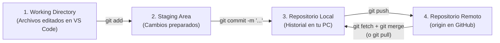

# Preprocesamiento de Datos de Homicidios — Ecuador (2010-2024)

## Descripción

Pipeline de preprocesamiento de datos de homicidios para Ecuador continental,
migrado desde R (En colavoración con los docentes) a Python 3.13. Incluye limpieza textual, numerica, validación geoespacial,
reparación de coordenadas corruptas y exportación de datos limpios para modelos
de series temporales.

## Requisitos

- Python 3.13 (usar `py -3.13` en Windows)
- Entorno virtual (`.venv`)
- Dependencias: ver `requirements.txt`

## Instalación

```powershell
# Crear entorno virtual
py -3.13 -m venv .venv

# Para permitir la ejecución de scripts solo para esta ventana abierta
Set-ExecutionPolicy Unrestricted -Scope Process

# Activar
.\.venv\Scripts\Activate.ps1

# Instalar dependencias
python -m pip install -r requirements.txt
```
## Eliminacion del entorno en caso de error (eliminar procesos python en adminsitrador de tareas)

```powershell
# Eliminar entorno virtual
Remove-Item -Recurse -Force .venv
```

## Forzar la cracion del entorno

```powershell
py -3.13 -m venv .venv --copies
```


## Uso

```powershell
# Activar el entorno virtual (si no está activo)
.\.venv\Scripts\Activate.ps1

# 1. Ejecutar el pipeline completo de extremo a extremo (Fases 1 a 5)
python main.py

# 2. Ejecutar de forma independiente los submódulos de la Fase 5
#    (leen directamente el artefacto georreferenciado de la Fase 4 sin repetir todo)
python -m src.exportacion.exportador          # Genera CSV, Parquet y GeoPackage (.gpkg)
python -m src.reportes.metricas_pipeline      # Genera auditoría JSON + resumen Markdown
python -m src.visualizacion.mapa_diagnostico  # Genera el mapa diagnóstico a 300 DPI

# 3. Ejecutar la batería completa de pruebas automatizadas (pytest)
python -m pytest tests/ -v
```

## Estructura del Proyecto

```
D:\Tesis\
├── data/
│   ├── raw/                  # Datos BRUTOS originales (inmutables)
│   │   ├── base_homi_2010_2025.csv
│   │   └── cartografia/      # Shapefiles cantonales (nxcantones.shp)
│   ├── interim/              # Puntos de control intermedios por fase (Parquet)
│   └── processed/            # Entregables FINALES limpios (CSV, Parquet, GeoPackage)
├── src/
│   ├── ingesta/              # Carga inicial y configuración centralizada (config.py)
│   ├── limpieza/             # Normalización textual (Fase 2) y filtros (Fase 3)
│   ├── validacion_geo/       # Cartografía, sjoin topológico, reparación decimal y ensamble (Fase 4)
│   ├── exportacion/          # Selección de 21 columnas, tipado y escritura multiformato (Fase 5)
│   ├── reportes/             # Auditorías de caracteres, conteos de control y métricas del pipeline
│   ├── visualizacion/        # Mapa diagnóstico continental desatendido a 300 DPI (Fase 5)
│   └── utils/                # Funciones transversales reutilizables (texto.py)
├── reports/                  # Salidas de auditoría (auditoria_pipeline.json/.md) y figuras/
├── notebooks/                # Jupyter para exploración
├── tests/                    # Pruebas unitarias y de integración (pytest)
├── R_legacy/                 # Código R original (referencia metodológica)
├── main.py                   # Orquestador general del pipeline
├── requirements.txt          # Dependencias Python
└── README.md                 # Documentación general y guía de Git
```

## Fases del Pipeline

| Fase | Descripción | Estado |
|------|-------------|--------|
| 1. Revicion de datos y Renombrado | Lectura CSV + renombrado 21 columnas | ✅ |
| 2. Limpieza Textual | Mayúsculas, tildes, espacios | ✅ |
| 3. Filtrado | Año ≤2024, sin Galápagos | ✅ |
| 4. Validación Geoespacial | Point-in-polygon + reparación coords | ✅ |
| 5. Exportación Final | CSV, Parquet, GeoPackage + Auditoría + Mapa | ✅ |
| 6. Series Temporales | Agregación, modelado (futuro) | ⬜ |

## Entregables Generados en la Fase 5

Al concluir la **Fase 5**, el sistema consolida las **21 variables limpias** definidas en `docs/diccionario_datos.md` (sustituyendo las cadenas crudas `latitud`/`longitud` por las coordenadas numéricas reparadas `lat_num`/`lon_num`, descartando columnas temporales como `ID_temp` y asignando tipos óptimos `string`, `datetime64[ns]`, `Int64`, `float64` y `category`) y produce seis artefactos verificables:

| Archivo Generado | Ruta | Propósito Técnico |
|---|---|---|
| **CSV Etiquetado** | `data/processed/homi_Final_Continental_Etiquetado.csv` | Tabla plana en codificación `UTF-8` (`index=False`) para interoperabilidad universal (Excel, R, SPSS, Stata). |
| **Parquet Optimizado** | `data/processed/homi_final.parquet` | Almacenamiento columnar binario (`pyarrow` + compresión `snappy`) que conserva intactos los tipos de datos (`datetime64`, `category`, `Int64`) para lectura inmediata en la Fase 6. |
| **GeoPackage Espacial** | `data/processed/homi_final.gpkg` | Contenedor vectorial estándar OGC en `EPSG:4326` (WGS84) listo para QGIS o ArcGIS. Reemplaza al formato legado `.shp`, evitando el límite de 10 caracteres en nombres de columna y la dispersión en múltiples archivos. |
| **Auditoría JSON** | `reports/auditoria_pipeline.json` | Registro estructurado con conteos del ciclo de vida completo (`47,739` brutos → `38,566` continentales → `38,565` finales), tasas de rescate y verificación de cuadre contable. |
| **Resumen Ejecutivo MD** | `reports/auditoria_pipeline.md` | Ficha resumen en formato Markdown lista para incorporar directamente en el documento de tesis. |
| **Mapa Diagnóstico** | `reports/figuras/mapa_diagnostico_continental.png` | Figura cartográfica renderizada en modo desatendido (`Agg`) a `300 DPI`: cantones en gris neutro (`#E0E0E0`), bordes provinciales disueltos y eventos puntuales con micro-jitter controlado. |

---

## Guía Rápida de Trabajo Colaborativo con Git

Esta sección explica paso a paso —con vocabulario claro pero técnicamente preciso— cómo coordinar el desarrollo entre compañeros sobre este repositorio (`origin`).

### 1. Conceptos Técnicos Fundamentales (Para Entender Qué Hace Cada Comando)

Antes de ejecutar comandos de memoria, conviene tener claros seis conceptos de la arquitectura interna de Git:

- **Repositorio local vs. Repositorio remoto (`origin`):** Git es un sistema distribuido. Tu carpeta `D:\Tesis` contiene una copia completa del historial en `.git` (**repositorio local**). `origin` es el alias estándar que apunta a la URL del servidor en GitHub (**repositorio remoto**), donde el equipo sincroniza su trabajo.
- **Las tres áreas locales de Git:**
  1. **Directorio de trabajo (*Working Directory*):** Los archivos que ves y editas en VS Code.
  2. **Área de preparación (*Staging Area* o *Index*):** Zona intermedia donde seleccionas (con `git add`) qué archivos modificados formarán parte de la siguiente confirmación.
  3. **Historial de confirmaciones (*Repository / Commits*):** Cada `git commit` guarda una instantánea inmutable identificada por un código criptográfico único (hash SHA-1, ej. `a3f9c12`).
- **Rama (*Branch*) y puntero `HEAD`:** Técnicamente, una rama NO duplica carpetas; es simplemente un **puntero ligero y móvil** que apunta al último *commit* de una línea de desarrollo (por ejemplo, `main`, `develop`, `feat/fase5_1.0`). `HEAD` es el puntero especial que indica **en qué rama estás ubicado actualmente**.
- **Diferencia entre `git fetch` y `git pull`:**
  - `git fetch origin` consulta GitHub y descarga en segundo plano la información de ramas y *commits* nuevos (`origin/develop`, `origin/feat/...`), **pero NO modifica tus archivos abiertos**. Es 100% seguro ejecutarlo en cualquier momento.
  - `git pull` equivale internamente a ejecutar **`git fetch` + `git merge`**: descarga los cambios del servidor y los fusiona inmediatamente en la rama donde estés ubicado.



> **Nota sobre `git switch` vs. `git checkout`:** En versiones modernas de Git (2.23+), el antiguo comando sobrecargado `git checkout` se dividió para evitar confusiones: **`git switch`** se usa específicamente para cambiar o crear ramas, aunque `git checkout` sigue funcionando exactamente igual por compatibilidad. Abajo se muestran ambos cuando aplica.

---

### 2. Cómo Saber Dónde Estás y Ubicarte en la Rama `develop`

En nuestro flujo de trabajo (**Gitflow simplificado**), `main` contiene versiones estables cerradas y **`develop`** es la rama troncal de integración donde se unen los avances del equipo antes de pasar a producción.

```powershell
# 1. Revisar en qué rama estás actualmente y si tienes archivos modificados sin guardar
git status
# IMPORTANTE: Antes de cambiar de rama, asegúrate de no dejar cambios a medias sin confirmar
# (debe decir "working tree clean", o bien guárdalos primero con git commit).

# 2. Actualizar el catálogo de ramas remotas desde GitHub sin tocar tus archivos aún
git fetch origin

# 3. Listar todas las ramas locales y remotas (-a = --all)
#    La rama que tiene un asterisco (*) al inicio es donde apunta tu HEAD actual.
git branch -a

# 4. Ubicarte en la rama develop
git switch develop
# (Equivalente clásico: git checkout develop)

# 5. Descargar e integrar los últimos commits que existan en GitHub sobre develop
git pull origin develop
```

---

### 3. Cómo Crear una Nueva Rama de Trabajo y Subirla a GitHub (`origin`)

Nunca conviene programar funcionalidades nuevas directamente sobre `main` ni sobre `develop`. La práctica profesional consiste en ubicarse primero en `develop` actualizado (sección anterior) y desde ahí abrir una rama temática (`feat/...` para código nuevo, `docs/...` para documentación, `fix/...` para correcciones):

```powershell
# 1. Partir siempre desde develop actualizado
git switch develop
git pull origin develop

# 2. Crear la nueva rama local y ubicarte en ella en un solo paso
#    La bandera -c (--create) crea el puntero de rama a partir del commit actual de develop
#    y mueve HEAD hacia esa nueva rama.
git switch -c feat/nueva-funcionalidad
# (Equivalente clásico: git checkout -b feat/nueva-funcionalidad)

# 3. Realizar tus cambios en el código y verificar qué archivos cambiaron
git status

# 4. Pasar los archivos modificados al Área de Preparación (Staging Area)
#    Puedes agregar archivos específicos o usar "." para incluir todos los cambios respetando .gitignore
git add src/ tests/ README.md
# (O para preparar todos los cambios del directorio actual: git add .)

# 5. Registrar el commit en tu historial local con un mensaje descriptivo
git commit -m "feat: implementa exportacion geoespacial y auditoria del pipeline"

# 6. Subir (publicar) por primera vez tu nueva rama al servidor remoto (origin)
#    ¿Qué hace la bandera -u (--set-upstream)?
#    Vincula tu rama local 'feat/nueva-funcionalidad' con su homóloga remota
#    'origin/feat/nueva-funcionalidad'. Gracias a esto, en los siguientes envíos
#    dentro de esta misma rama te bastará escribir únicamente: git push
git push -u origin feat/nueva-funcionalidad
```

---

### 4. Cómo Hacer `merge` (Fusión de Ramas)

Un **`merge`** toma el historial de *commits* de una **rama origen** y lo integra dentro de la **rama destino donde estás ubicado actualmente (`HEAD`)**. Regla técnica fundamental: **primero te ubicas en la rama que va a RECIBIR los cambios, y desde ella ejecutas `git merge <rama-que-trae-los-cambios>`**.

Existen dos escenarios cotidianos al trabajar con tu compañero:

#### Escenario A: Integrar en `develop` una rama terminada (tuya o de tu compañero)
Supongamos que tu compañero (o tú) ya subió la rama `feat/trabajo-companero` a GitHub y desean incorporarla oficialmente a `develop`:

```powershell
# 1. Traer de GitHub todas las referencias recientes de todas las ramas
git fetch origin

# 2. Ubicarse en la rama receptora (develop) y asegurarse de tenerla al día
git switch develop
git pull origin develop

# 3. Fusionar la rama de trabajo dentro de develop
#    --no-ff (opcional recomendado) conserva explícitamente en el historial gráfico
#    que esos commits provinieron de una rama de funcionalidad.
git merge origin/feat/trabajo-companero

# 4. Ejecutar las pruebas automatizadas para confirmar que la unión no rompió nada
python -m pytest tests/ -q

# 5. Subir la rama develop ya actualizada a GitHub para que quede disponible para todos
git push origin develop
```

> **Alternativa recomendada en GitHub (Pull Request):** También pueden hacer este mismo *merge* desde la interfaz web de GitHub abriendo un **Pull Request** con base `develop` ← compare `feat/trabajo-companero`. Permite revisar línea por línea los cambios antes de fusionar.

#### Escenario B: Actualizar TU rama en curso con lo nuevo que tu compañero ya subió a `develop` (u otra rama)
Supongamos que estás trabajando en tu rama `feat/mi-avance`, pero tu compañero acaba de actualizar `develop` (o subió avances en `origin/docs/comentarios`) y necesitas traer esos cambios hacia tu rama actual para no trabajar sobre código viejo:

```powershell
# 1. Confirmar (commit) tus propios cambios locales antes de fusionar nada
git status
git add .
git commit -m "wip: guarda avance local antes de sincronizar con develop"

# 2. Descargar las novedades del servidor remoto
git fetch origin

# 3. Asegurarte de estar ubicado en TU rama (la que va a recibir la actualización)
git switch feat/mi-avance

# 4. Fusionar los nuevos commits de develop remoto hacia tu rama actual
git merge origin/develop
# (Si quisieras traer cambios directamente desde otra rama específica de tu compañero,
#  usarías: git merge origin/nombre-rama-companero)

# 5. Subir tu rama ya sincronizada a GitHub
git push
```

#### ¿Qué ocurre si aparece un Conflicto de Fusión (*Merge Conflict*)?
Si tú y tu compañero modificaron **exactamente las mismas líneas del mismo archivo**, Git no decide arbitrariamente cuál conservar; pausa el *merge* y marca el archivo con delimitadores estándar:
- Entre `<<<<<<< HEAD` y `=======` verás lo que tenías en tu rama actual.
- Entre `=======` y `>>>>>>> origin/develop` verás lo que viene de la otra rama.

**Cómo resolverlo limpiamente en VS Code:**
1. Abre el archivo marcado en conflicto; VS Code mostrará botones de ayuda (*Accept Current Change*, *Accept Incoming Change*, *Accept Both Changes*) o puedes editar el código manualmente dejando la versión correcta y borrando las líneas `<<<<<<<`, `=======`, `>>>>>>>`.
2. Marca el conflicto como resuelto agregando el archivo al *staging*: `git add ruta/del/archivo.py`.
3. Cierra la fusión ejecutando: `git commit` (Git propondrá automáticamente el mensaje de cierre del *merge*) y luego `git push`.
*(Si en algún momento te equivocas durante un conflicto y quieres cancelar la fusión para volver exactamente a como estabas un segundo antes, ejecuta: `git merge --abort`).*

---

### 5. Cómo Actualiza tu Compañero su Computadora para Tener Todo al Día

Cuando tú terminas de subir cambios a GitHub (`git push`), tu compañero NO los recibe automáticamente hasta que sincroniza su repositorio local. Tiene dos casos posibles:

#### Caso 1: Tú actualizaste `develop` (o una rama que él ya tenía descargada antes)
Tu compañero debe ejecutar en su terminal:

```powershell
# 1. Ubicarse en develop (cuidando no tener cambios sin confirmar que choquen)
git switch develop

# 2. Descargar y fusionar los nuevos commits desde GitHub
git pull origin develop

# 3. (Solo si se agregó alguna librería nueva en requirements.txt)
.\.venv\Scripts\Activate.ps1
python -m pip install -r requirements.txt
```

#### Caso 2: Tú creaste y subiste una rama NUEVA que él todavía NO tiene en su PC
Por ejemplo, tú acabas de hacer `git push -u origin feat/fase5_1.0`. Si tu compañero intenta hacer `git switch feat/fase5_1.0` de inmediato, Git le dirá que no la conoce porque su repositorio local aún no ha consultado al servidor. Debe hacer lo siguiente:

```powershell
# 1. Consultar a GitHub para descargar la lista e historial de ramas nuevas
git fetch origin

# 2. Verificar que ahora sí aparece como 'remotes/origin/feat/fase5_1.0'
git branch -a

# 3. Crear la rama local vinculada automáticamente a la remota y ubicarse en ella
git switch feat/fase5_1.0
# Explicación técnica: al no existir 'feat/fase5_1.0' localmente pero sí existir
# exactamente una rama remota 'origin/feat/fase5_1.0', `git switch` crea la rama
# local con seguimiento (tracking) automático hacia origin.
# (Equivalente explícito tradicional: git checkout -b feat/fase5_1.0 origin/feat/fase5_1.0)

# 4. De ahí en adelante, cada vez que tú subas más commits a esa misma rama,
#    a tu compañero le bastará estar en ella y ejecutar:
git pull
```

---

### 6. Tabla de Comandos Rápidos de Diagnóstico Diario

| Comando | Qué hace técnicamente |
|---|---|
| `git status` | Muestra la rama actual (`HEAD`), archivos modificados en el *Working Directory* y archivos preparados en *Staging*. |
| `git branch -vv` | Lista tus ramas locales indicando el último *commit* y a qué rama remota (`origin/...`) está vinculada cada una, incluyendo si estás adelantado (`ahead`) o atrasado (`behind`). |
| `git fetch origin --prune` | Descarga novedades de GitHub y limpia (`--prune`) referencias locales a ramas remotas que ya fueron borradas en GitHub. |
| `git diff` | Muestra línea por línea (`+` verde / `-` rojo) qué cambiaste en tus archivos antes de hacer `git add`. |
| `git log --oneline --graph --all -n 12` | Dibuja en consola el árbol compacto de los últimos 12 *commits* y fusiones de todas las ramas. |

---

## Origen de Datos

- **Fuente**: Base de datos proporcinadas por el docente de homicidios en Ecuador
- **Periodo**: 2010-2025 (filtrado a 2024 para análisis)
- **Formato original**: RDS/CSV con 21 columnas codificadas
- **Registros**: ~40,000 casos de homicidios en Ecuador


## Extenciones recomendadas
Vizualizacion de los archibos tipo parquet: Parquet Visualizer - lucien-martijin

Para la vizualizacion de archibos .md: Markdown Preview Mermaid Support - bierner. (Ctrl + Shift + V)


